<div align="center">

# Pet to Character

**Turning ordinary phone photos of your own cat into a playable game character.**

An R&D case study (September to October 2026): segmentation, identity extraction, multi-view references, image-to-3D generation, retopology to a 3,500-triangle budget, rigging, and an 8-direction sprite walk cycle running in a Godot room.


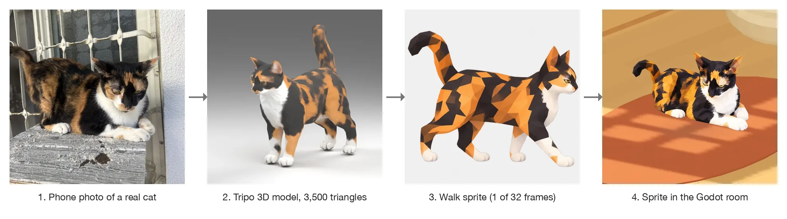

*Real photo, then the photo-grounded Tripo 3D model decimated to exactly 3,500 triangles, then the 2D sprite route the project moved to: a walk-cycle frame and the sprite inside the Godot room.*

</div>

This repo holds the code, the per-stage review reports and the result images from **61 logged events across 46 numbered experiment folders** (the 36 most representative are included here). Every stage got its own pass/fail check, and I kept the failed attempts next to the accepted ones, because most of what I learned came from them.

---

## Results at a glance

| Area | Result |
|---|---|
| Triangle budget | **3,500 exactly**, from a 5,356-triangle Tripo model, with 0 boundary edges and surface deviation p95 = **0.14%** of model extent |
| Budget method | Tripo basic decimate v1.0: **10 credits, 17 to 26 s**, no hand-placed regions (native `face_limit` returned 5,128 / 5,501 and failed the budget) |
| 3D generation | Photo-constrained four views to Tripo multiview: **40 credits, 195 s** server time, four legs, cheek asymmetry kept |
| Per-cat 3D cost | About **50 Tripo credits and 4 minutes** of service time, plus image calls for the reference views |
| Material bug caught | Dropped `metallicFactor` turned fur into metal (RGB difference 24 to 31/255); restored to **1.6 to 2.5/255** |
| Rig and animation | 56-bone skeleton, every frame of 5 clips measured (**597 frames**); walk max edge stretch **10.3 to 4.16** |
| Engine integration | **22 automated Godot checks** pass; live walk/sit loop in the room |
| Sprite walk | **8 directions x 4 frames = 32 frames**, 627x627 native cells, click-to-move over **552 reachable cells** |
| Evidence trail | `review.json` per experiment, `action_gate.json` written before newer runs, 61-event history |

---

## Contents

1. [The product idea](#1-the-product-idea)
2. [Why it is hard](#2-why-it-is-hard)
3. [Pipeline](#3-pipeline)
4. [Stage by stage](#4-stage-by-stage)
5. [Budgets and measurements](#5-budgets-and-measurements)
6. [Cost and quality trade-offs](#6-cost-and-quality-trade-offs)
7. [Product decisions: observed, inferred, edited](#7-product-decisions-observed-inferred-edited)
8. [How I ran the experiments](#8-how-i-ran-the-experiments)
9. [Where it stands](#9-where-it-stands)
10. [What I'd do next](#10-what-id-do-next)
11. [Project structure](#11-project-structure)
12. [Running the offline pieces](#12-running-the-offline-pieces)

---

## 1. The product idea

**Your own pet as a playable character.** A player takes 1 to 3 photos of their cat. The game gives back a stylized low-poly cat that walks and sits in a small cozy room, and the player should be able to look at it and say "that's my cat".

What has to survive is the cat's **identity**: face patches (especially left/right asymmetry), coat color layout, eye color, white chest and paws, ear and tail shape. What has to be imposed is the game's **art style**: clean faceted shapes, flat color areas, soft light.

<table>
<tr>
<td width="38%">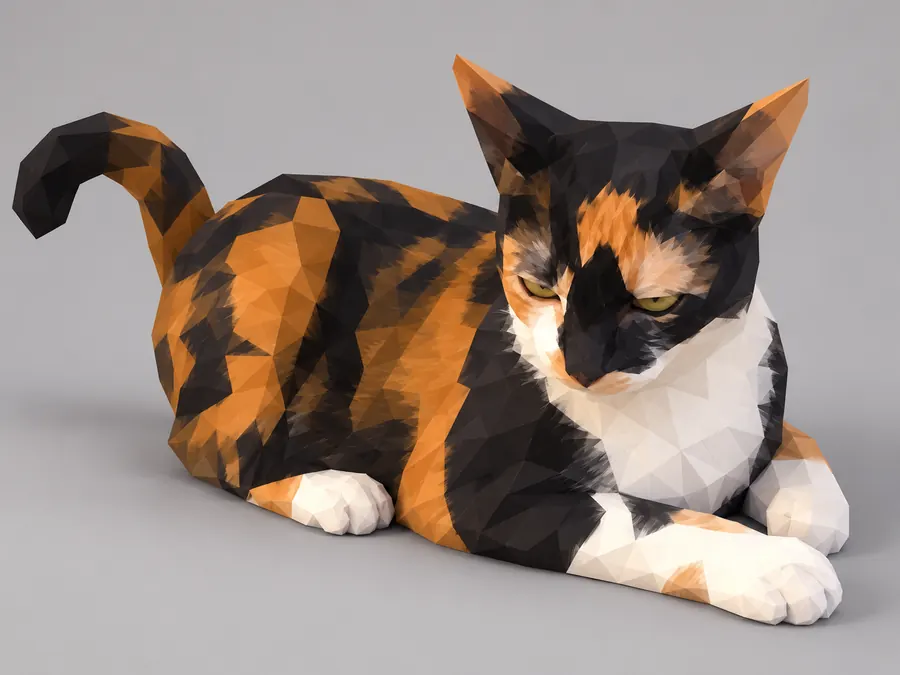</td>
<td>

**Art target.** The reference for the art direction: a faceted low-poly calico with flat color areas.

**Sample input.** The project's own cat, a calico with a strongly asymmetric face (orange on her right cheek, black on her left), which makes left/right mistakes easy to see.

</td>
</tr>
</table>

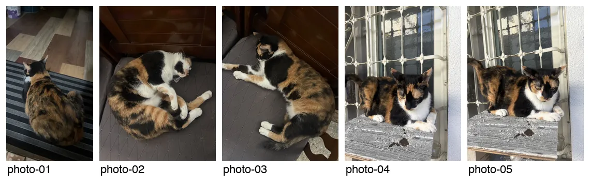

## 2. Why it is hard

- **Photos are partial evidence.** Pet photos are sleeping curls, top-down shots and half-occluded faces. The back, belly and far side are often never seen. Anything the system fills in there is a guess, and the product has to treat it as one.
- **Left/right is easy to flip.** Image-left is the cat's right. Mirroring a side view to save a generation silently swaps a calico's cheeks.
- **Generative models drift.** Each image or 3D generation can add a leg, move a patch, or re-draw the face. "The API returned 200" says nothing about whether it is still the same cat.
- **Game constraints fight fidelity.** A mobile-friendly character needs a fixed triangle budget (I used 3,500), clean topology, sane materials, and a skeleton that animates without tearing. Each step down the pipeline can undo the identity gained upstream.
- **Style and identity pull in opposite directions.** Simplifying a coat into big flat facets is the art style. Simplifying it too much erases the patches that make the cat recognizable.
- **One good result proves little.** A hand-tuned fix for one cat is a demo. The real question at every stage was: would this work on the *next* cat with no new manual points, masks or code branches?

## 3. Pipeline

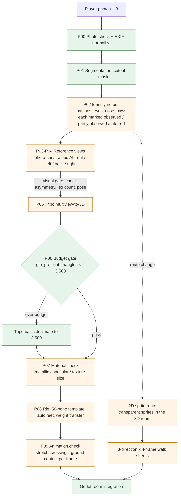

Green: the stage meets its own technical check on the sample cat. Orange: it works, but quality (identity, art or animation) did not fully pass review, or it still needs a human judgment call. Every stage so far has been run on one cat; the cross-cat plan is in [section 10](#10-what-id-do-next).

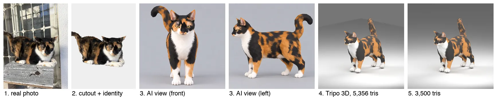

*Real photo, cutout and identity notes, photo-constrained AI views, Tripo 3D (5,356 triangles), provider decimation to exactly 3,500 triangles.*

## 4. Stage by stage

Each heading links to its experiment folders. Every folder has a `review.json` (what was measured and decided). Newer ones also have an `action_gate.json` written *before* running (purpose, scope, manual dependencies, stop condition).

### Route A: recolor a fixed template ([route-a-template/](route-a-template/))

The first plan: take one pre-rigged template cat (a licensed low-poly asset pack, not included here) and only change its colors, so every player's cat shares topology, UVs, skeleton and all 23 animations.

| Try | Result |
|---|---|
| v001: project photo pixels into the template UV | **Rejected.** It brings photographed fur and room lighting into the texture. It looks like a photo pasted on a mesh, not the art style. |
| v002: hand-interpreted coat regions, simplified polygons, baked to UV | Clean, but needs manual interpretation for every cat. |
| v003: semantic labels voted per triangle (45 samples/triangle), flat per-face colors | Geometry, UVs, weights and animation hashes are identical before and after, so all 23 animations still work. But the template's narrow face and fixed proportions didn't read as *this* cat. |

**Finding:** a shared template solves animation, but identity is more than coat color. Body shape and face structure count too. That pushed me to per-cat generated geometry, and animation became the hard part instead.

### P00 to P02: input, segmentation, identity ([00](experiments/00-input), [01](experiments/01-segmentation), [02](experiments/02-identity))

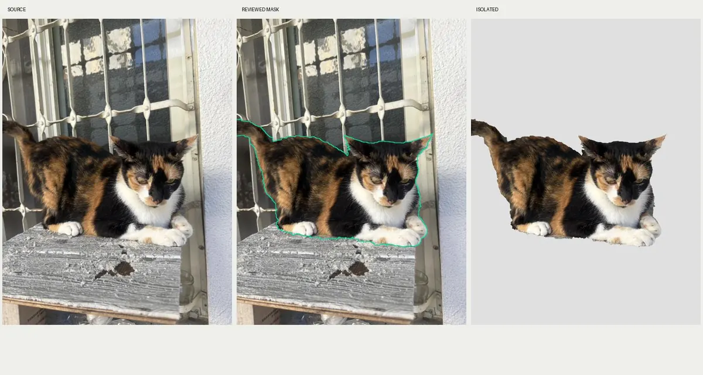

- Photos are EXIF-rotated and normalized; originals are never modified. Hashes are in `manifest.json`.
- Segmentation: GrabCut from a reviewed silhouette seed ([`pipeline/prepare.py`](pipeline/prepare.py)).
- Identity: a structured list of features (`face_right_orange`, `face_left_black`, `nose_pink`, `bib`, `paws`, `back_nape`, `eyes`), each with source photos and an evidence level: `observed`, `partly_observed` or `inferred`.

**What didn't work:** both stages still need hand input (seed contour, crop boxes, feature boxes). A rectangle GrabCut on the back-view reference picked up the floor shadow. Using the 3D render's silhouette as a prior raised IoU to 0.928 but forced background into a misaligned ear, so a high mask IoU is **not** independent evidence that the cutout is right.

### P03 to P04: reference views ([03](experiments/03-style), [04](experiments/04-views), [20](experiments/20-standing-reference), [21](experiments/21-tripo-multiview), [22](experiments/22-photo-constrained-views))

Image-to-3D models need a clear standing view, but the photos show a cat lying down. So the pipeline generates reference views.

| Try | Result |
|---|---|
| Four independent AI views, manually cropped and scaled ear-tip to floor (04) | Proportions, legs and tail disagreed across views, and that sent five legs into 3D (below). |
| One standing reference (04b, 20) | Four legs, but only one side of the face is ever seen. |
| Tripo's native image-to-multiview from one image (21): 10 credits, 21 s | Fast and consistent, **but it invented the unseen cheek wrong**. The asymmetric face came out symmetric. Rejected before spending 40 credits on 3D. |
| **Photo-constrained views (22):** each view generated with the real photos that show that side as conditioning; 5 image calls | **Kept.** Right cheek orange, left cheek black, black shoulders, no invented white collar on the back, no extra limbs. One front-pose correction. |

<p>
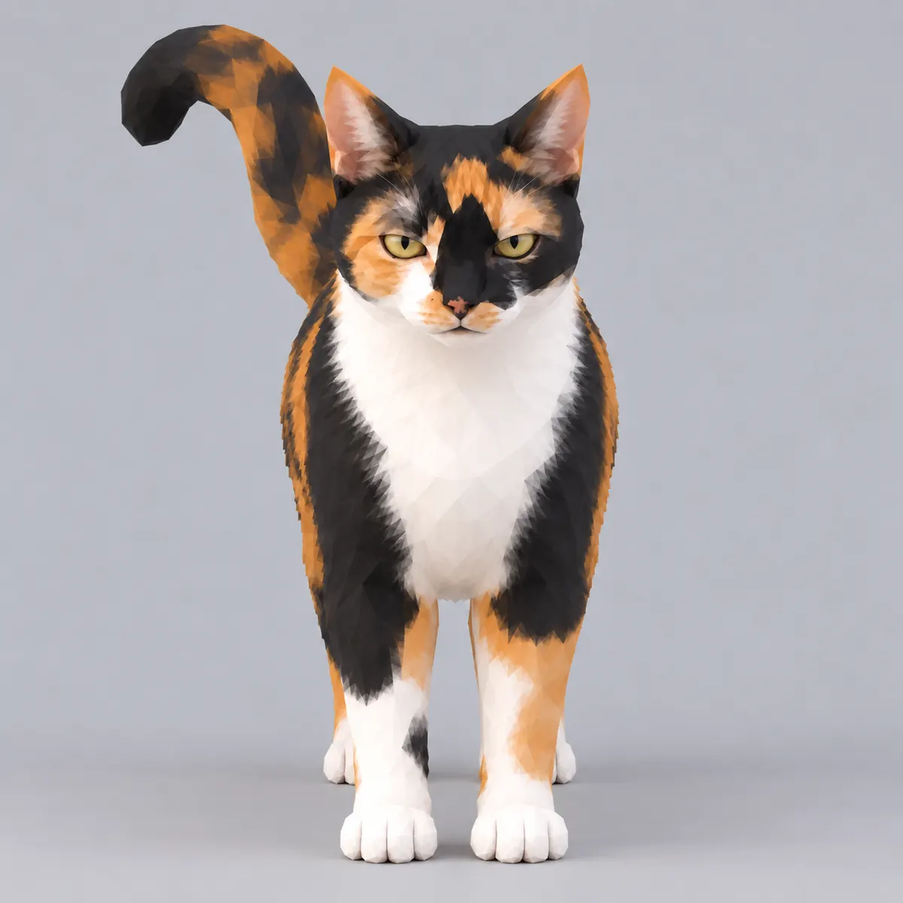
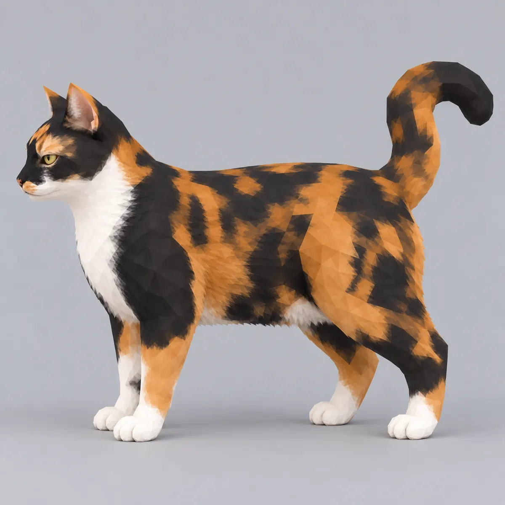
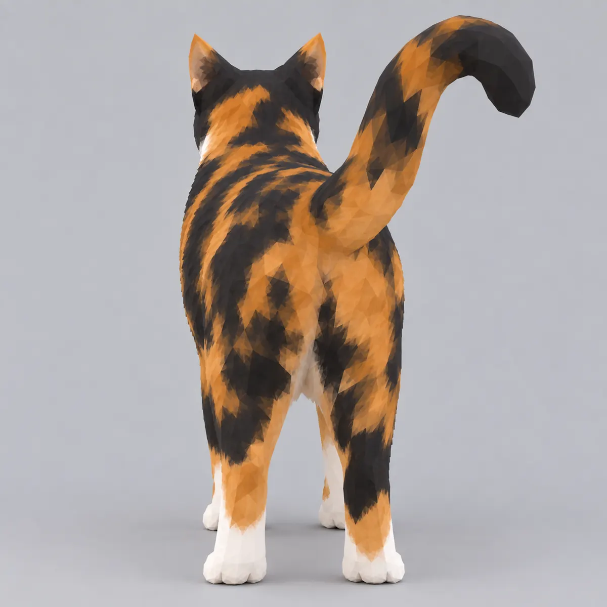
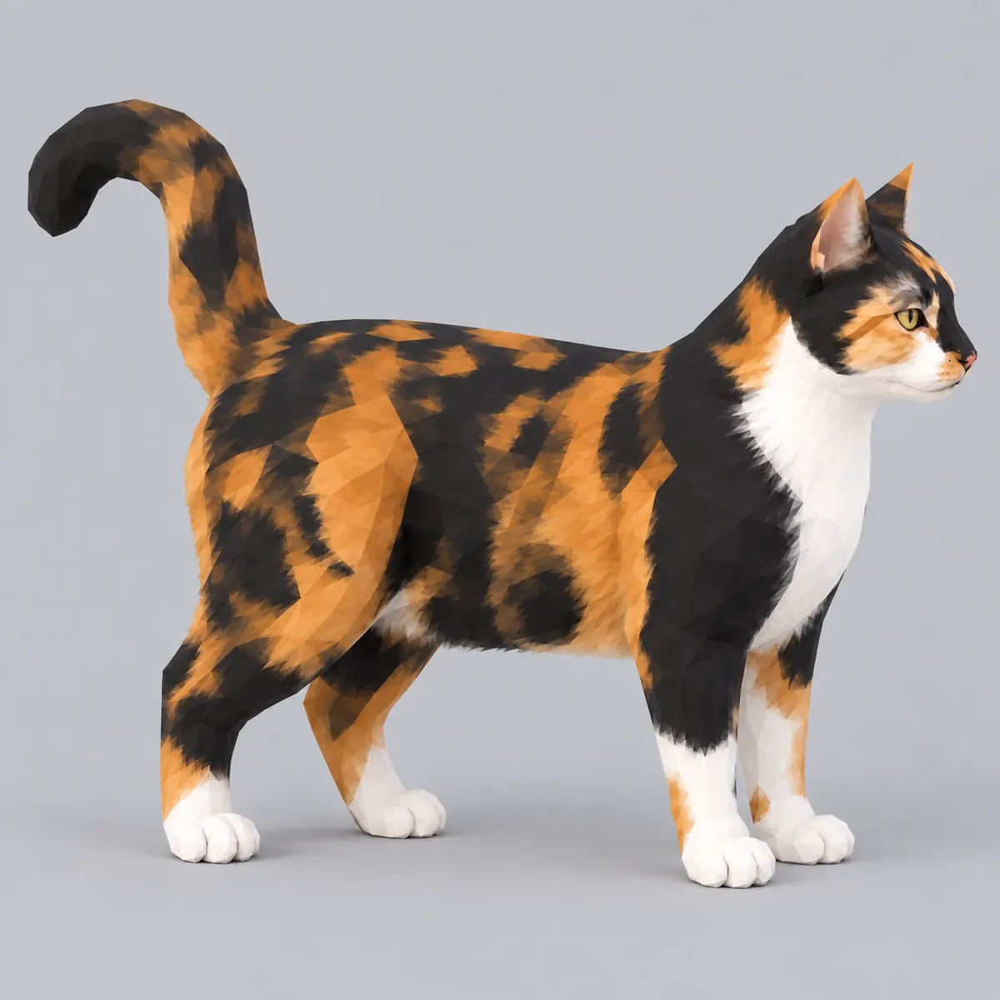
</p>

**Finding:** "more views" only helps if every view is grounded in a real photo of that side. A generated view is not an observation.

### P05: image to 3D with Tripo ([05](experiments/05-tripo), [06](experiments/06-raw-model), [06b](experiments/06b-repair), [06c](experiments/06c-raw-single), [23](experiments/23-multiview-3500))

| Input | Result |
|---|---|
| Four inconsistent views (05/06): 210 s | Watertight, one component, 0 boundary edges, **and five legs**. Every topology check passed while the anatomy failed. |
| Local repair of the extra leg (06b) | Both repair candidates rejected (cap artifacts, non-manifold edges). Going back upstream was cheaper than patching. |
| One standing view (06c): 177 s | Four legs, but the art and the hidden side didn't pass. |
| **Photo-constrained four views (23):** 40 credits, 195 s server time | **Kept.** 5,356 triangles, 0 boundary/non-manifold edges, four legs, cheek asymmetry visible on the actual 3D model. |

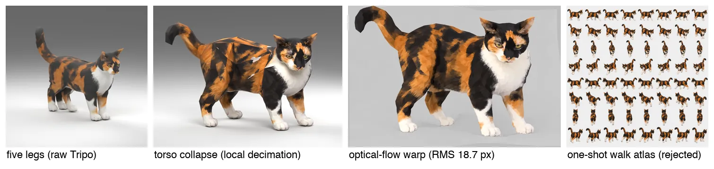

**Finding:** I added [`pipeline/glb_preflight.py`](pipeline/glb_preflight.py) and [`pipeline/inspect_geometry.py`](pipeline/inspect_geometry.py) as automatic gates, but they can only reject. They can't approve anatomy, which still needs a semantic check (leg count, tail, face side).

### P06: the 3,500-triangle budget ([14](experiments/14-budget-3500), [15](experiments/15-tripo-native-3500), [16](experiments/16-service-retopology), [24](experiments/24-multiview-budget))

| Approach | Triangles | Time / cost | Outcome |
|---|---|---|---|
| Local Blender decimation, weighted head/paw protection (14 v001) | 3,500 | free | **Rejected:** torso collapsed into large folded faces, UV bleeding. |
| Local decimation, balanced weights + rebake (14 v002) | 3,500 | free | Usable, but depends on hand-placed head and paw zones for this cat (`x>0.15, z>0.18 m`). Doesn't generalize. |
| Tripo native `face_limit=3000` / `3500` (15) | **5,128 / 5,501** | 40 credits, 190 s | **Budget failed.** The server confirmed it received 3500, and two independent counters agree on the output. The parameter didn't hold for this model version. |
| Tripo smart decimate v2.0 (16) | 4,422 | 30 credits, 98 s | **Rejected:** over budget, 11 boundary + 14 non-manifold edges. |
| **Tripo basic decimate v1.0** (16, 24) | **3,500 exactly** | **10 credits, 17 to 26 s** | **Kept.** 0 boundary edges; surface deviation p95 = 0.14% of model extent; no manual regions. |

<p>
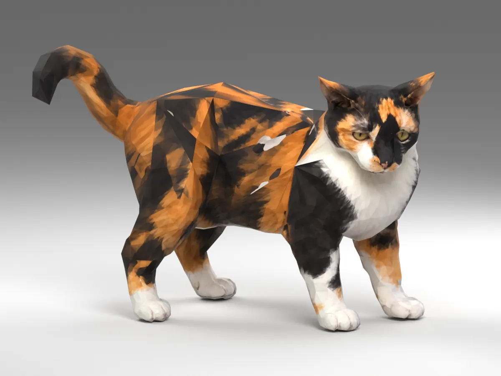
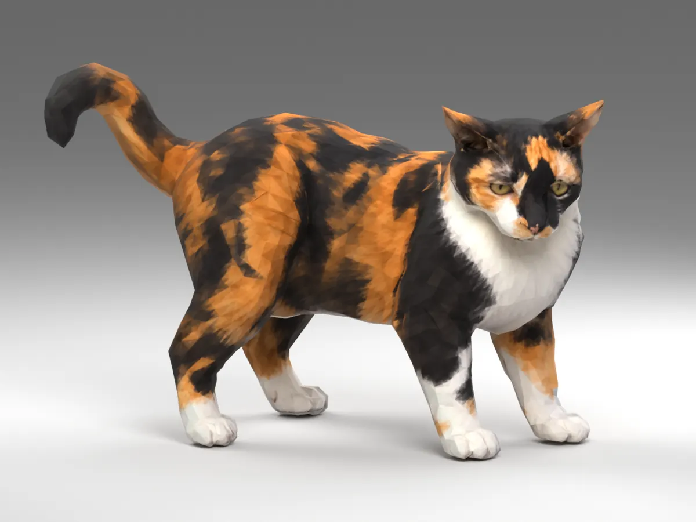
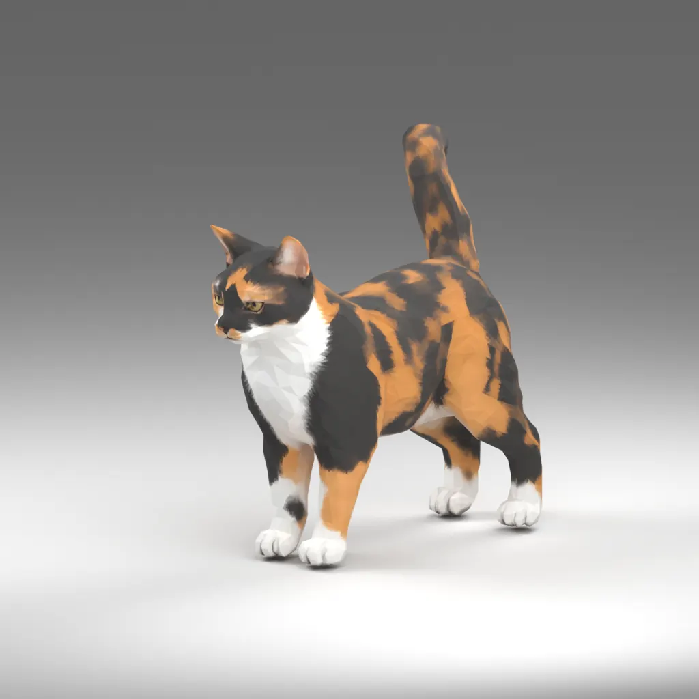
</p>

*Left to right: local decimation v001 (rejected), local v002 (needs per-cat hand zones), Tripo basic decimate on the multiview model (kept, 3,500 triangles).*

**Hidden bug I found:** basic decimation silently dropped `metallicFactor=0`. glTF's default is 1, so the fur rendered as metal (RGB difference 24 to 31/255 against the source). [`restore_processed_materials.py`](pipeline/restore_processed_materials.py) copies the source material and rebakes, which brings the difference down to 1.6 to 2.5/255. On the later multiview model (24) the material survived, so no rebake was needed. The check stays in the pipeline either way.

**Finding:** "native first, verify, then post-process only if needed" beat "always decimate locally". The cheapest provider option was also the most predictable one.

### P07: appearance and art style ([08b](experiments/08b-coat), [12](experiments/12-auto-registration), [25](experiments/25-appearance-diagnostic), [26](experiments/26-adaptive-facet-color))

- **Projecting reference colors onto the mesh** worked on the visible side with 52 hand-placed control points. To remove those points, I tried dense optical flow (OpenCV DIS) for automatic alignment (12), using the hand points only for scoring. v001 lowered RMS error from 25.0 to 18.7 px but left 16 points over 15 px and folded 8% of the field. v002 (boundary-assisted) got *worse* (29.0 px). **Rejected both:** a low pixel residual is not the same as correct body-part correspondence.
- **Why the coat looked gray** (25): an ablation over 8 renders showed specular reflection added about 16 to 17 luma levels (out of 255) of graying. A provisional matte setting (`specularFactor 0.3`) changes only the glTF JSON, and the binary buffers stay byte-identical. It is included as [`experiments/25-appearance-diagnostic/matte-candidate/cat.glb`](experiments/25-appearance-diagnostic/matte-candidate/cat.glb). Its material name was anonymized, so its hash differs from the one in the review.
- **Adaptive facet color** (26): flatten each UV triangle's texels to one color when the Lab spread is under a threshold (ΔE 18 or 28), preserving high-variation areas. It covered 88% / 95% of the texture, kept 3,500 triangles and left preserved pixels byte-identical. **Rejected:** measurable, but not enough visible style gain.

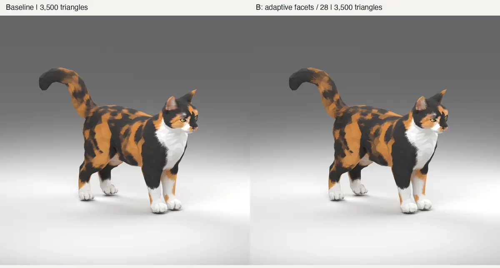

### P08 to P09: rigging and animation ([27](experiments/27-animation-compatibility), [28](experiments/28-part-aware-rig), [29](experiments/29-walk-sit-scope), [31](experiments/31-catworld-integration), [32](experiments/32-single-cat-scene))

Goal: drive the generated mesh with a 56-bone cat skeleton and its clips, without hand-placed joints or hand-painted weights.

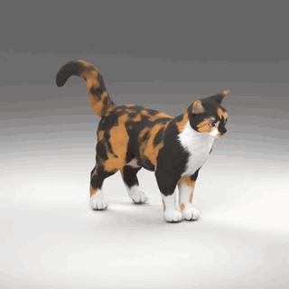

- **27, auto rig:** feet found automatically from low connected regions of the standing mesh. Scale/offset derived from foot centers. Weights transferred from the nearest template surface, then one generic smoothing pass (5 rounds, 0.35, max 8 influences). I measured every frame of 5 clips (597 frames). GLB export round trip: max deformation error 4.2e-5.
- **28, part-aware fit:** surface-path part segmentation plus ARAP-constrained fitting, stress-tested on 5 synthetic body shapes (long legs, short legs, fat, thin, short-fat) x 15 poses. **Rejected:** it regressed animation (Idle crossings 19 to 42). The previous version stayed.
- **29:** I narrowed the scope to two behaviors, walk and sit (4 clips), and stopped tuning outside that scope.
- **31 and 32, engine integration:** the rigged cat runs in an existing Godot 4 room. 22 automated integration checks pass, and a live behavior loop runs (walk, then sit after about 14.6 s).

<br clear="right">

| Clip (27, before → after smoothing) | Self-crossing pairs | Max edge stretch | Edges stretched > 2x |
|---|---|---|---|
| Idle (260 f) | 29 → 19 | 2.80 → 1.73 | 6 → 0 |
| Walk (27 f) | 107 → 73 | 10.3 → 4.16 | 164 → 26 |
| Sitting (240 f) | 451 → 304 | 4.73 → 2.66 | 126 → 14 |

**Result: clearly better and measurable frame by frame, with known gaps before shipping:** some stretching and intersection remain, and the sit clips dip below the ground plane (lowest point -0.04 model units).

### The route change: 3D mesh to 2D sprites in a 3D room ([32](experiments/32-sprite-workflow) to [39](experiments/39-hires-walk))

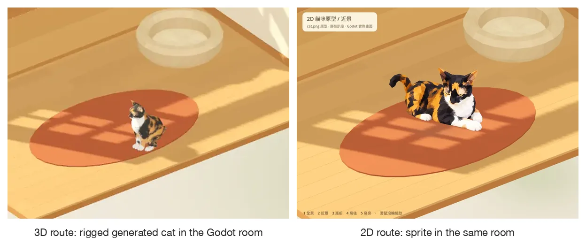

A read-only style analysis of the room (31) explained why the 3D cat looked pasted in. The room is big simplified warm shapes (about 3,000 triangles for the whole room), while the cat models carry realistic anatomy and dense high-contrast markings. With a fixed orthographic camera and weak ground contact, a 2D character is a reasonable fit: **the 3D room keeps positions, collisions and depth, and the cat becomes transparent sprites.** This also removes UVs, skinning and the triangle budget from the per-cat problem.

Each change was tested as a strict A/B: one factor changed, same camera and asset, and the baseline replay was checked to be pixel-identical.

| Exp | Change | Result |
|---|---|---|
| 33 | Static transparent sprite in the room | Alpha, separate ground shadow and furniture depth occlusion verified. The ground pivot was set by hand. |
| 34 | Turn on scene lighting for the sprite | Slightly warmer and darker, not more "in" the scene. **Not adopted.** |
| 35 | Contact shadow | Local improvement only. **Not adopted.** |
| 36 | AI simplification of facets | Less noise, but the outline and canvas shifted, so paws sank under the fixed pivot. **Not adopted.** |
| 37 | Click-to-move on a grid built from room collision (552 reachable cells) | **Passed:** reroutes mid-walk, stops on command, rejects targets inside the bed or outside the room, height error about 0. |
| 38 | One-shot 8-direction walk atlas from an image model | **Rejected:** blurry, facets lost, identity drifted between frames. |
| 39 | 8 separate high-resolution sheets, 4 native 627x627 frames each (32 frames) | **Kept as a playable prototype:** distance-driven gait phase, limited turn speed, slow-down on sharp turns, accel/decel, frame registration from one shared alpha rule (no per-frame hand pivots). |

<table>
<tr>
<td width="50%">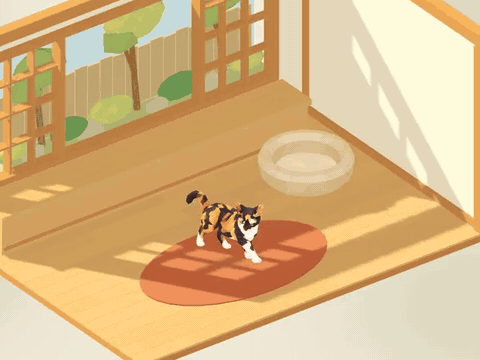</td>
<td>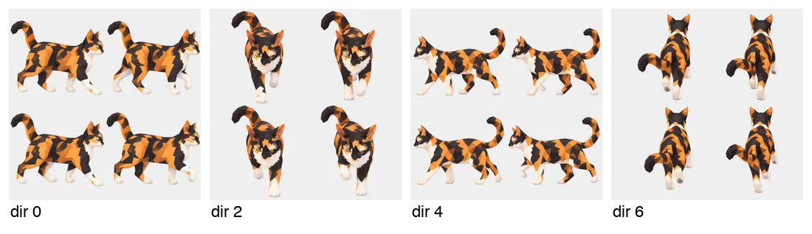</td>
</tr>
<tr>
<td><em>Engine capture from experiment 39 (first 10 s of the <a href="experiments/39-hires-walk/evidence/walk-demo.mp4">22 s recording</a>).</em></td>
<td><em>Four of the eight direction sheets, 4 frames each.</em></td>
</tr>
</table>

**Known limits of 39:** 4 frames per direction still reads as stepped. Coat patches drift slightly between directions. The back coat is inferred. There's no dedicated idle or stop transition yet, and no per-foot ground lock, so feet can slide.

## 5. Budgets and measurements

| Item | Value | Where |
|---|---|---|
| Triangle budget | 3,500 (exported triangles, counted from the GLB index buffer and cross-checked in Blender) | [`glb_preflight.py`](pipeline/glb_preflight.py) |
| Raw generation | 5,356 to 5,501 triangles from a 3,000 to 3,500 request | 15, 23 |
| Decimation fidelity | surface distance p95 = 0.14% of extent, 0 boundary / non-manifold edges | 24 |
| Texture | 2048² base color; metallic 0, roughness 0.9 | 23, 25 |
| Rig | 56 bones, 8 influences/vertex, 4 clips shipped to the engine | 27, 29, 31 |
| Animation check | per-frame self-crossings, edge stretch, collapsed faces, lowest point vs ground | [`bake_and_measure.py`](experiments/27-animation-compatibility/bake_and_measure.py) |
| Engine checks | 22 Godot integration checks; live walk/sit loop | 31 |
| Sprite walk | 8 directions x 4 frames, 627x627 native cells, no upscaling | 39 |
| Review artifacts | `review.json` per experiment, `action_gate.json` before newer runs, [`records/experiment-history.json`](records/experiment-history.json) (61 events), [`records/automation-review.json`](records/automation-review.json) (issues, fixes, generalization limits) | |

Acceptance is split on purpose. **Geometry, identity, art style, export, animation and engine behavior each pass or fail on their own.** Hitting the triangle count, getting an API success or one good-looking render never counts as "done".

## 6. Cost and quality trade-offs

| Decision | Cheaper option | What it cost in quality | Choice |
|---|---|---|---|
| Reference views | Tripo single-image multiview: 10 credits, 21 s | Wrong unseen cheek | Photo-conditioned views (5 image calls + review) |
| 3D generation | Generate from one view | Hidden side guessed | Four grounded views; 40 credits, about 3.5 min |
| Hitting 3,500 triangles | Local decimation (free) | Torso collapse, or per-cat hand zones | Provider basic decimate: 10 credits, about 20 s, plus a material check |
| Smarter retopology | Smart decimate: 30 credits, 98 s | Over budget, broken edges | Not used |
| Fixing bad 3D locally | Patch the mesh | Two rejected repairs, still per-cat | Fix the upstream reference instead |
| Animation | Full 23-clip library | Each clip needs its own contact/IK fixes | Walk + sit only |
| Character format | 3D mesh (budget, UV, rig) | Style mismatch with the room, animation defects | 2D sprites in the 3D room |

A rough per-cat 3D cost from the logged runs: **about 50 Tripo credits and 4 minutes of service time** (40 for generation + 10 for decimation), plus the image calls for the reference views. Human review time wasn't timed during the experiments, so I don't report a number for it (see `missing_historical_metrics` in [`automation-review.json`](records/automation-review.json)).

## 7. Product decisions: observed, inferred, edited

The core product rule I took from this work: **the player should always be able to tell what came from their photo, what the system guessed, and what they changed.**

| Layer | Examples | How the system treats it |
|---|---|---|
| **Observed** (the photo shows it) | Face patches, eye color, white bib, visible paws | Locked as identity. Generation must not change it. Checked at every stage. |
| **Inferred** (the system fills it in) | Back coat, belly, far-side legs, standing proportions from a lying cat | Marked `inferred` in the identity data and shown as editable. Never promoted to "observed". |
| **Player-edited** | Patch color, a corrected cheek, body width, ear size | Saved separately and kept across regenerations. A template update must not silently change a saved cat. |

Supporting decisions:

- **Fail in a way the player can act on.** Proposed runtime states: `accepted`, `retry_with_reason`, `needs_more_photos` ("we need a photo of her left side"), `needs_review`, `failed`. Low confidence leads to asking for a specific extra photo, not a silent guess.
- **The real photo sets identity, the game sets style.** The calico prototype's patches are never a default for other cats.
- **The saved cat is data, not just a mesh:** template/version, shape parameters, regional appearance, evidence level per region, player edits, and generated assets. That keeps a cat reproducible and editable.
- **Privacy:** strip EXIF, set a retention and deletion policy, and ask separately before using player photos for training.

## 8. How I ran the experiments

The project's working rules ([`docs/notes-zh/working-rules.md`](docs/notes-zh/working-rules.md), in Chinese) require five questions to be answered before each significant run:

1. **Purpose:** which product requirement does this move forward, without lowering the bar on identity, style, budget or animation?
2. **Automation:** if the player swaps in a different cat, can this step get its inputs, run, check itself and handle failure on its own?
3. **Scope:** is this a general rule, a one-time art setting, a per-cat parameter derived automatically, or a one-off patch?
4. **Case necessity:** if it's a one-off, does it answer a general question?
5. **Evidence and stop condition:** how will the result be compared, and when do I stop retrying?

These are written to `action_gate.json` before execution. Gates added later for older runs are labeled `retrospective`, not passed off as planned. Each experiment keeps its inputs (with hashes), parameters, the exact executed source (`executed-source.py`), the failures and the outputs. Rejected candidates are kept next to the accepted ones.

## 9. Where it stands

**Working on the sample cat:**

- Photos to grounded four views to a clean 3,500-triangle textured 3D model with the cheek asymmetry intact, using automatic budget and topology gates and no hand-placed regions in the 3D stages.
- That model rigged and walking/sitting in a Godot room, with per-frame deformation metrics.
- A playable 8-direction sprite walk with pathfinding in the same room.

**Scope of the evidence:** everything so far ran on one cat, so the results above show that each stage can work and how to measure it, not yet how often it works across cats. The next section is built around closing that gap.

## 10. What I'd do next

- **Measure generalization on a held-out set of cats.** The plan in `automation-review.json` covers solid, black-and-white, calico and tabby coats, different body shapes and photo quality. The metrics are ready: share of cats passing all gates with no human edits, false-pass rate (especially wrong-side patches and anatomy), re-shoot rate, human minutes per cat, cost and latency per cat, and whether owners recognize their cat.
- **Automate segmentation and identity extraction.** Replace the hand seed contours and feature boxes with a detector that outputs masks, visible parts, left/right side and confidence, and asks for a specific photo when unsure.
- **Make animation robust on generated meshes.** Add part-level correspondence (body / four legs / head-neck / tail) before weight transfer, plus foot-contact IK, which addresses belly-leg mix-ups at the source instead of relying on smoothing.
- **Scale the sprite route safely.** Add a consistency check that rejects identity and composition drift between frames, then extend to more directions and actions, with idle/stop transitions and foot locking.

## 11. Project structure

```
README.md                    this case study
docs/images/                 figures used above
docs/notes-zh/               original product spec, sprite workflow and working rules (Traditional Chinese)
pipeline/                    the shared scripts (Python, Blender bpy, Tripo API client)
experiments/NN-name/         curated experiments: review.json, action_gate.json, prompts,
                             executed sources and downscaled result images
records/                     experiment-history.json (61 events), automation-review.json,
                             automation-evidence/ (topology measurements, e.g. five-leg.json)
route-a-template/            the fixed-template recolor route (template mesh not included: licensed asset)
workflow-validation/         offline Tripo request contract + tests, route comparison notes
```

**Notes on the curated copy**

- Most review files and prompts are in Traditional Chinese, the working language of the project. Field names, numbers and many newer reports are in English.
- Images were downscaled and converted to WebP/JPEG to keep the repo small. JSON reports still name the original `.png` files. The two GIFs above were made from the MP4s already in the repo.
- Left out: `.blend` scenes, `.npz` caches, raw GLBs, the licensed template cat and its animations, the game room assets, Tripo task IDs and task-status files (replaced with `<redacted-id>`), and local launchers.

## 12. Running the offline pieces

Two parts run on a plain Python 3 install with no API key and no Blender:

```bash
# Tripo request contract: rejects configurations that would silently change intent or waste a paid task
cd workflow-validation
python3 -m unittest -v test_front_end_contract

# Triangle-budget gate on the included 3,500-triangle model
cd ..
python3 pipeline/glb_preflight.py experiments/25-appearance-diagnostic/matte-candidate/cat.glb /tmp/preflight.json --triangle-limit 3500
# -> {"active_scene_triangles": 3500, "budget_pass": true, "status": "budget_pass"}
```

The rest of the scripts are kept exactly as they ran. They expect the original working-tree layout, Blender 5.2 (`bpy`, `mathutils`), Python with `numpy`, `scipy`, `opencv-python`, `Pillow` and `requests`, and Godot 4.7 for the engine experiments. The Tripo client reads `TRIPO_API_KEY` from the environment (or a local `.env` that is git-ignored). No key is stored in this repo.

---

Built by Hao-Fu Chang.

## License

© 2026 Hao-Fu Chang. All rights reserved.
