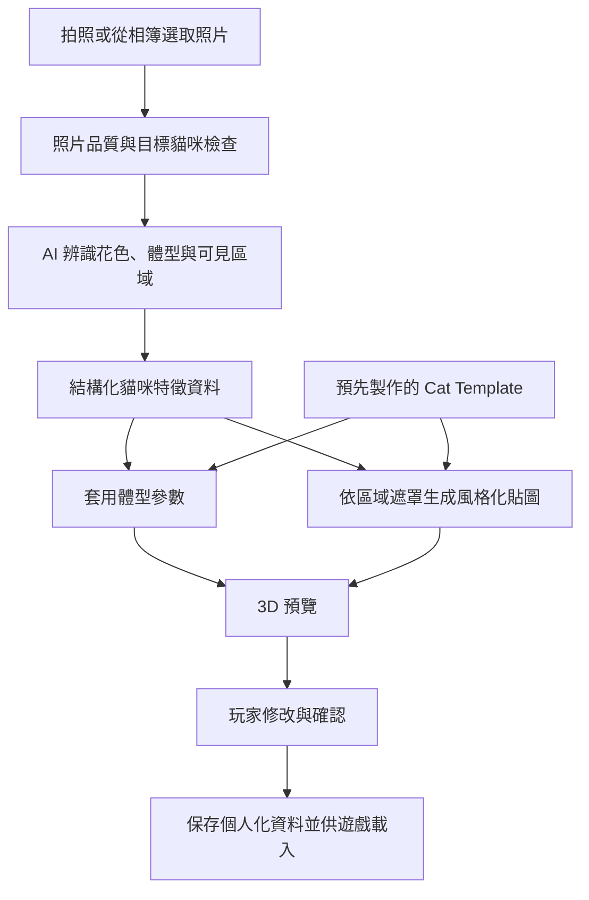

> Original working notes in Traditional Chinese, copied as written. Some links point to files that were left out of this curated repo; images were converted to `.webp`.

# 個人化貓咪生成系統

玩家拍照或從相簿選取自己貓咪的照片，系統自動生成具有該隻貓外觀特徵的 **low-poly 3D 貓模型**。

希望玩家看到結果時，能認出「這是我家的貓」。優先保留臉部花紋、毛色分布、眼睛顏色，以及明顯的體型、耳型與尾巴特徵。

目前為需求與技術規劃階段。本文件整合兩份討論；下列 MVP 範圍與技術路線是起步建議，尚未代表功能已實作或效果已驗證。

## 1. 產品目標

- **輸入：** 玩家拍攝或從相簿選取的貓咪照片。
- **輸出：** 可預覽、可調整，並能整合到遊戲中的個人化 low-poly 貓模型。
- **美術方向：** 乾淨、風格化、有明確色塊與輪廓，保留每隻貓的辨識特徵。
- **自動化範圍：** 基礎資產由開發團隊預先製作；日後每位玩家的個人化生成不應依賴人工逐隻建模。
- **遊戲資產方向：** 同一模板版本內共用拓樸、UV、骨架與動畫，讓不同玩家的貓能使用相同的遊戲動作。

## 2. 玩家使用流程

1. 拍照或從相簿選取照片，第一版建議以 **1–3 張**即可開始。
2. 系統檢查是否能清楚辨識貓咪；模糊、遮擋嚴重或有多隻貓時，引導玩家更換照片或指定目標。
3. AI 分析花色、臉部特徵、眼睛與鼻子顏色，以及主要體型特徵。
4. 系統將辨識結果套用到標準貓模板，生成個人化外觀。
5. 玩家旋轉模型預覽，修正顏色、花紋與體型。
6. 確認後儲存，供遊戲載入；是否另外提供模型檔下載，待使用情境確認。

照片不必是同一姿勢。優先引導玩家提供清楚的臉部與全身照片；需要改善相似度時，再補充側面、背部或尾巴照片。照片未呈現的區域應標示為推測，並允許修改。

## 3. 第一版建議路線

採用 **固定 Cat Template＋AI 辨識外觀特徵＋程序化貼圖＋少量體型參數**。

| 討論中的選項 | 第一版建議 | 原因與限制 |
| --- | --- | --- |
| 每隻貓從照片重新生成 mesh | 保留為概念驗證工具 | 輸出的拓樸、UV 與綁骨規格仍需逐項驗證，不能直接假設可共用動畫。 |
| 共用貓模板，再改變花色與體型 | 作為核心架構 | 資產規格可控，個人化資料可獨立保存，便於預覽與編輯。 |
| 從照片精準擬合大量形變參數 | 延後研究 | 第一版先以約 5–8 個明顯的外型控制項驗證效果，讓玩家能修正 AI 判斷。 |
| 將照片像素直接投影到 UV | 延後研究 | 不同姿勢、遮擋與照片光影會增加對齊和風格統一的難度。 |
| 辨識身體區域的花色，再生成貼圖 | 第一版優先驗證 | 便於統一美術風格與局部修改；細小、不規則的斑紋仍可能需要更精細的遮罩。 |
| 強制拍攝 5–8 個指定角度 | 改為選擇性補充 | 先降低開始使用的門檻，再依缺失區域引導補拍。 |

「專屬模型」可以由共用模板與每隻貓獨有的資料組合而成。玩家得到的外觀各不相同，底層仍可使用同一套骨架與動畫。

## 4. 生成流程



AI 可先使用視覺語言模型（VLM）分析照片並輸出結構化資料；使用哪個模型或服務，待樣本測試後決定。輸出必須通過欄位、數值範圍與合法選項檢查，才能套用到模型。

### 花色處理原則

- 在模板 UV 上定義可編輯區域，例如額頭、左／右臉、鼻樑、下巴、胸口、背部、腹部、四肢與尾巴分段。
- 左右以貓咪本身為準；避免把照片畫面的左右直接當成身體左右。
- 保存區域顏色、花紋類型與特徵斑塊，優先保留臉部與左右不對稱的花色。
- 使用統一調色盤與遮罩繪製貼圖，避免把照片的室內光色、陰影直接畫進毛色。
- 區分「照片可見」「系統推測」「玩家修改」；缺少資訊的區域允許補全，不應覆蓋已確認的特徵。
- 區域只是編輯與定位的基礎；若單區單色無法表現三花、虎斑或特殊臉斑，再增加區域內的圖案與斑塊遮罩。

## 5. 資產與個人化資料

### 開發團隊預先製作的 Cat Template

- 一隻中立站姿的短毛成年貓，具備適合動作變形的拓樸。
- 固定 UV、身體區域遮罩、材質與調色盤。
- 骨架、蒙皮權重，以及經過驗證的體型調整範圍。
- 少量必要動畫，例如待機、走路、坐下與睡覺。
- 依目標平台需求製作 LOD（不同細節層級）。

Blender 可作為基礎資產製作工具；貼圖工具與遊戲引擎尚待選定。討論中的 Unity、Substance 3D Painter 等屬於候選方案。

原討論提出的 LOD0 約 6,000–10,000 三角面、1K／2K 貼圖可作為測試起點，最終規格需依裝置效能、鏡頭距離與同時顯示的貓咪數量決定。第一版不以完成數十個 morph 或動畫為前提。

### 每隻貓生成與保存的資料

```text
PersonalizedCat
├── templateId / templateVersion   使用的模板及版本
├── shape                         胖瘦、臉型、耳朵大小、尾長等參數
├── appearance                    區域花色、圖案、眼睛與鼻子顏色
├── evidence                      可見／推測區域與辨識信心資訊
├── userEdits                     玩家確認或修改的內容
└── texture                       最終生成的貼圖
```

遊戲若已具備對應版本的模板，便可載入個人化資料與貼圖來呈現該隻貓。正式欄位、參數範圍與貼圖格式需另行定義，並保留足以重新產生相同外觀的設定。

同一模板家族與版本內維持一致的資產規格；不同 LOD 需要各自建立相容的形變與蒙皮。體型變化是否影響腳掌接地、尾巴或動作變形，仍需逐項驗證。

## 6. MVP 範圍

### 第一版要完成

- 只支援短毛成年貓，先用單一模板驗證完整流程。
- 拍照／相簿輸入、照片檢查、生成進度與失敗後重試。
- 約 5–8 個容易感知的外型控制項；實際項目與安全範圍以模板測試決定。
- 選取一組代表性花色測試，例如單色、黑白、三花與虎斑，記錄各類效果。
- 個人化貼圖、3D 旋轉預覽、局部換色與體型微調。
- 儲存與重新載入同一隻貓，並驗證共用骨架與基本動畫可正常運作。

### 後續再評估

- 長毛貓、幼貓，以及需要額外幾何支援的特殊耳型或尾型。
- 精準多視角重建、照片到 UV 的投影、大量形變參數擬合。
- 自行訓練完整 3D 生成模型或端到端個人化模型。
- 完整動畫庫、複雜互動、旅行與明信片等遊戲玩法。
- 收費、免費重生成次數、確認後扣款，以及模型下載／匯出功能。

原始需求尚未確定付費與明信片玩法，因此它們不列為生成系統的必要條件。

## 7. 實作順序

1. **先驗證外觀表現：** 使用同一個模板，手動做出幾隻不同花色的貓，確認玩家能辨識個體差異，並找出區域遮罩的不足。
2. **建立資料與編輯規格：** 定義區域、調色盤、體型控制項與資料版本，讓預覽器能讀取資料並即時修改。
3. **接上照片辨識：** 將 AI 輸出轉成同一份資料格式，以玩家修正結果檢查辨識品質。
4. **完成自動生成流程：** 加入上傳、背景任務、進度、錯誤處理、貼圖產生與保存。
5. **驗證遊戲整合：** 測試不同體型與花色在相同骨架、動畫及目標裝置上的表現，再決定是否擴大模板與技術投入。

## 8. 驗收重點

| 面向 | 要驗證的結果 |
| --- | --- |
| 個體相似度 | 玩家能辨識自己的貓，尤其是臉斑、左右花色與主要輪廓；以實際玩家回饋驗證。 |
| 可修正性 | 能修改判斷錯誤的區域，且重新生成時保留玩家已確認的內容。 |
| 風格一致性 | 不同光線下的照片仍能產生符合統一美術方向的外觀。 |
| 動作相容性 | 支援範圍內的體型能共用基本動畫，沒有明顯破面、穿模或接地問題。 |
| 保存一致性 | 重新載入後外觀一致，模板更新不會無預警改變已保存的貓。 |
| 成本與等待時間 | 量測生成成功率、耗時與每次成本後，再設定服務目標；目前沒有已驗證的時間承諾。 |

照片處理需納入移除不必要的 EXIF、保存期限與刪除機制。照片是否可另作訓練用途，應與生成角色的用途分開取得同意。商用模板、貼圖、動畫與第三方模型也需記錄來源及使用授權。

## 9. 待確認事項與研究方向

- 主要使用平台、遊戲引擎，以及模型是在遊戲中使用或需要提供檔案下載。
- 第一版要支援的花色、體型差異與可接受的相似度。
- 玩家主要觀看方式：近距離 3D 互動、遠景角色，或靜態構圖；這會影響模型、貼圖與動畫優先順序。
- 可接受的等待時間、每次生成成本，以及低品質結果的處理方式。

兩份討論提到 Meshy／Tripo、PetLovesYou／Avapaw，以及 Animal Avatars、RAC、BARC／BITE、SMAL 等產品或研究，可作為後續查證清單。本次整理未重新驗證它們的現況、能力與授權，也不據此判定市場上沒有同類產品。

目前優先驗證的問題是：**用可控的模板、花色資料與編輯介面，能否讓玩家以簡單的操作得到一隻認得出來的專屬貓咪。**
