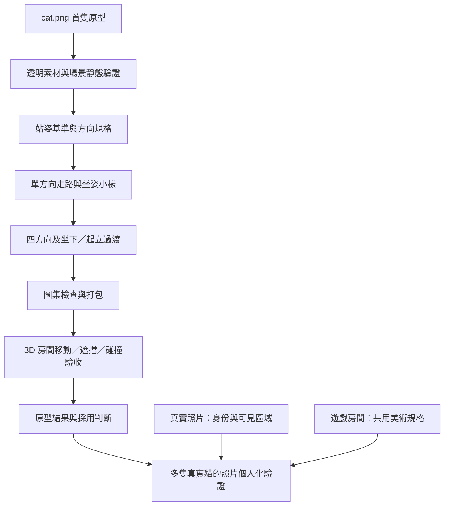

> Original working notes in Traditional Chinese, copied as written. Some links point to files that were left out of this curated repo; images were converted to `.webp`.

# 個人化貓咪生成 Workflow：3D 房間＋2D Low Poly 角色

更新日期：2026-10-01  
**最新修正：** 使用者已拒絕33的風格及靜態交付；34實驗改以遊戲房間畫風為準，並要求實際移動、走路影格與坐姿。本輪進行中，不沿用「只做靜態」作為交付終點。  
目前狀態：**S00–S01 已完成單張趴姿的房間實驗，保留為靜態候選；完整品質尚未通過。** 站姿、多方向、走路／坐姿動畫與跨貓個人化尚未執行。

[近景實際畫面](../../experiments/33-sprite-static/evidence/02-close.webp) · [房間全景](../../experiments/33-sprite-static/evidence/01-overview.webp) · [實驗紀錄](../../experiments/33-sprite-static/review.json)。單張透明圖、獨立陰影及家具深度已實測；去背會重畫部分切面，落地仍依賴一組人工 pivot，不能宣稱全自動。

以 [cat.png](../images/cat-art-target.webp) 為首隻角色的外觀原型，保留既有 Godot 3D 房間，讓透明 PNG 逐格動畫在房間中移動與切換動作。製作及執行這條流程，都不以建立貓咪 3D 模型為前提。

本文件是目前嘗試路線；[readme.md](product-spec.md) 保留原產品規劃，不加入實驗內容。[舊 3D workflow 快照](../../experiments/32-sprite-workflow/workflow-3d-before.md)與既有實驗保留作歷史，原文中的「目前／最新」只代表封存當時。舊快照內的相對連結以原專案根目錄為基準。

## 1. 目標與邊界

### 首隻原型

- 依最新使用者修正：**遊戲房間是美術標準**，採大色塊、簡化造型與柔和低反差明暗；`cat.png` 只保留三花分布、臉斑、眼睛與耳尾等辨識特徵，不再要求複製其細碎切面。
- 房間沿用既有 3D 場景。角色呈現改成 2D 圖片，位置、碰撞及遮擋仍在 3D 世界處理。
- 第一版沿用已選定的**行走＋坐姿**行為；逐步補齊坐下／起立過渡。站姿是素材基準和轉場端點，不另擴張成一套待機行為。
- `cat.png` 現有姿勢是趴姿，可先做靜態場景驗證；去背不會自動得到站姿、走路、坐姿或背面。
- 趴著、母雞蹲、眨眼、呼吸與尾巴待機留作後續擴充，不列入首輪必做動作。

### 後續個人化

產品目標仍是玩家換一隻貓後，系統依照片產生認得出來的角色。到這一階段，**真實照片決定個體身份，遊戲房間決定美術風格**；不能把原型的三花斑紋套到每隻貓。

這次路線變更使「約 3500 三角面、UV、3D 骨架與蒙皮」不再是 2D 貓的交付要求，這些規格保留在舊 3D 支線。新的資產成本看貼圖解析度、總影格、記憶體、透明繪製與實機效能；尚未量測，不預先保證更省或更快。

## 2. 場景與美術共用規格

已唯讀確認 `catworld/godot/main.gd` 使用固定方向的正交鏡頭，並支援縮放和跟隨。鏡頭方向為 `Vector3(-1.05, 1.05, 1.40)`，推算俯角約 31°。首輪沿用這個鏡頭；`cat.png` 的視角是否匹配，仍需實際放入場景比較。

| 項目 | 本路線規格 |
| --- | --- |
| 畫風 | 以房間的簡化形體、大色塊與暖色柔光為準；保留貓的辨識特徵，減少細碎切面和高反差。 |
| 鏡頭 | 固定方位與俯角，允許縮放／跟隨；自由繞視及俯仰變化另立需求。 |
| 圖片 | 真正含 alpha 的透明 PNG；移除背景及原圖地面投影，保留身體本身明暗。 |
| 尺度 | 同一隻貓跨方向與姿勢共用世界尺寸，不逐幀把包圍盒拉成同樣大小。 |
| 落地 | 共用角色根位置及明確的地面支撐基準；不直接以尾巴、陰影或最低非透明像素當腳底。 |
| 朝向 | 從角色相對鏡頭的移動方向選圖；Billboard 只負責朝向鏡頭，不產生新視角。 |
| 左右花色 | 以貓自身左右記錄；三花不對稱，不用水平翻圖冒充另一側。 |
| 光影 | 先以不受場景燈光影響的圖片作對照，再驗證共用調色／受光方案；避免重複照亮已畫入圖中的明暗。 |
| 地面陰影 | 獨立於角色 PNG，跟隨角色落在地面；共用柔和陰影也須檢查漂浮、穿插與方向。 |

正交鏡頭下不加「距離越遠，角色越小」公式，也不另算等角畫面座標；位置交由 3D 相機投影。[Godot Camera3D](https://docs.godotengine.org/en/stable/classes/class_camera3d.html)

## 3. 整體流程



每一階段未通過時，先返回該階段處理；不把問題一路帶到完整圖集。以下是各階段規格；S00–S01 的實測與限制見第 7 節，S02–S07 仍待執行。

## 4. 分階段執行與停止條件

### S00｜鎖定原型、來源與規格

**輸入：** `cat.png`、既有房間／鏡頭設定、行走與坐姿範圍。  
**輸出：** 輸入 hash、風格與身份對照、鏡頭／尺寸規格、素材清單和本次 `action_gate`。

先區分三種資料：AI 原型圖、真實照片、遊戲實際截圖。`cat.png` 看不到的另一側及背面屬於未知；首隻原型如需補全，標記為設計推測。若要宣稱還原真實貓，須由照片補充證據。

**人工依賴：** 首次風格規格及可見特徵檢閱。  
**驗收／停止：** 原型、動作、鏡頭和未知區域有明確紀錄後才進入素材生成；不把 AI 推測寫成照片已確認。

### S01｜一張透明貓圖放進房間

**輸入：** `cat.png`。  
**輸出：** 保留原趴姿的透明 PNG、房間全景／近景實際截圖、接地與遮擋紀錄。

以影像工具去背景，保留完整耳朵、尾巴、腳掌與花色；將圖片放在實驗房間的 `Sprite3D` 上，加入獨立地面陰影。在近景和正常遊戲大小下檢查比例、圖片俯角、透明邊緣、黑白毛色，以及家具前後的遮擋。若測位置移動，標示為「靜態圖平移」，不當成行走動畫。

**自動化方向：** 檢查 alpha、裁切、檔案規格與匯入；共用相機和場景測試點。  
**人工依賴：** 身份／風格與場景融合審查；支撐點若無可靠推導，記為人工依賴，不能默默用本例座標放行。  
**驗收／停止：** 一版素材，最多一次針對已定位問題的修正。若俯角、透明邊緣或貼地仍有明顯錯誤，保留失敗並停止擴張方向／影格。

### S02｜站姿基準與四方向設計

**輸入：** 通過 S01 的風格／鏡頭規格及原始參考。  
**輸出：** 一個完整站姿基準，再建立四方向設計圖與方向索引。

先固定體型、頭臉、眼睛、耳尾與花色，再改姿勢。先測一個方向，合格後擴展四方向。方向角度以實際相機與地面運動為準，在 metadata 中明列；不把世界方向、畫面方向和貓自身左右混用。

四方向是原型起點，不宣稱已等同八方向效果。若斜向移動的轉向跳變不可接受，再比較八方向的新增成本與效果。未知面的補全一旦採用，就保存成該原型版本的設計基準，後續影格不能自行更換斑紋。

**自動化方向：** 共用參考條件與提示詞範本，按方向參數產生；檢查尺寸、完整性與方向標記。  
**人工依賴：** 四方向身份與解剖一致性審查；自動辨識花色跨視角對應尚未證明可用。  
**驗收／停止：** 每個測試單位一版、最多一次受控修正。出現換臉、花色左右顛倒、肢體增減或鏡頭不一致時不進入動畫批量生成。

### S03｜單方向走路與坐姿小樣

**輸入：** 同一方向的已確認站姿。  
**輸出：** 一個短走路循環、坐姿靜幀與可逐幀檢查的播放預覽。

走路先試 4–6 格；實際幀數與播放速度依步態檢查調整，不當成已驗證規格。所有影格引用同一角色設計，明確指定步態相位；不能只把幾張不同站姿連播就稱為走路。坐姿指屁股落地、前腳支撐，與趴姿／母雞蹲分開。

把「世界移動速度」與「步態週期／步幅」一起檢查。先測原地循環，再測前進，檢查落腳期間是否滑動、身體是否抽動，以及循環首尾是否跳幀。

**自動化方向：** 播放／逐幀比對、資料完整性、root／支撐基準與位移紀錄；關鍵腳掌的語義定位尚待驗證。  
**人工依賴：** 步序、重心、花色穩定及接地視覺審查。固定提示詞或同批生成不保證跨幀一致。  
**驗收／停止：** 一個循環及一次受控修正為上限。若仍需逐幀重畫斑紋、手改大量支撐點或遮罩，判定此生成方法未通過，不繼續量產整套。

### S04｜擴展四方向，補坐下／起立

**輸入：** 通過 S03 的步態和坐姿。  
**輸出：** 四方向走路、四方向坐姿，以及坐下／起立過渡。

先完成各方向的循環，再補姿勢過渡；保持角色尺寸與根位置一致。切方向時對應相同或相近的步態相位，避免反覆從第一格開始。坐下／起立期間按動作規格處理世界位移；初版可先停止根位置移動。

**自動化方向：** 由 manifest 建立動畫與轉換關係，驗證缺圖、方向、相位和起終點。  
**人工依賴：** 各方向與轉場連續性的審查；不預設坐下動畫倒播就一定是合格起立。  
**驗收／停止：** 分方向／動作小批處理，每批一版及最多一次受控修正。任一必要方向或轉場不合格，保留為不完整候選；靜態姿勢直接切換只能稱為初步展示。

### S05｜整理、對齊與圖集打包

**輸入：** 已審查的影格及語義標記。  
**輸出：** RGBA PNG／圖集、`manifest.json`、Godot `SpriteFrames` 資源與檢查結果。

統一畫布、透明 padding、命名、幀序與 root 座標。裁切時保留原始畫布偏移，避免每幀重新置中造成抖動。可以自動量測包圍盒，但不能用它取代腳掌支撐或角色根位置的語義判斷。圖集加入適當邊界，實測縮放與濾波是否串色。

**人工依賴：** 上游未能可靠提供 root、支撐點或步態相位時仍需審查；不能為這隻貓新增大量座標後宣稱通用。  
**驗收／停止：** 尺寸、alpha、幀序、資源連結、缺圖及重載結果全部通過；無法可靠對齊的批次返回上游，不無限疊加修補。

### S06｜Godot 房間與行為整合

**輸入：** 完整動畫資產、既有房間的實驗副本。  
**輸出：** 可點地板移動、停下坐著、再次起立行走的可操作原型，及實際遊戲截圖／影片。

```text
Cat（CharacterBody3D）
├── CollisionShape3D       角色簡化碰撞形狀
├── NavigationAgent3D      需要尋路時使用，須有可用導航資料
├── AnimatedSprite3D       按狀態／朝向播放影格
└── GroundShadow           獨立地面接觸陰影
```

角色控制器管理世界位置；`AnimatedSprite3D` 透過 `SpriteFrames` 管理外觀動畫。[Godot AnimatedSprite3D](https://docs.godotengine.org/en/stable/classes/class_animatedsprite3d.html)

遮擋使用場景深度，保持 `no_depth_test=false`。透明重疊有問題才比較 Alpha Cut 等設定及邊緣品質；Billboard 與深度測試仍無法給平面角色完整立體體積，家具穿插須實測。[Godot SpriteBase3D](https://docs.godotengine.org/en/stable/classes/class_spritebase3d.html)

需要繞家具時，先建立／確認可行走導航區、家具碰撞和角色尺寸。`NavigationAgent3D` 提供路徑，控制器仍要執行位移；加節點本身不等於已完成尋路與避障。佈置改變後需更新對應資料。[Godot NavigationAgents](https://docs.godotengine.org/en/stable/tutorials/navigation/navigation_using_navigationagents.html)

**驗收：** 全景／近景、四方向、開始／停止／再移動、循環／轉場、家具前後／邊緣、接觸陰影、可達／不可達目標、資產重新載入。只有空地直線移動通過時，不能宣稱房間導航通過。  
**停止：** 完成約定測試場景後記錄結果；遇到平面遮擋或動畫資產限制，返回對應階段。未通過必要品質項時不替換正式角色。

### S07｜真實照片個人化與跨貓驗證

**輸入：** 其他真實貓的照片、共用風格和素材規格。  
**輸出：** 各貓獨立的角色素材、來源證據、失敗分類與生成成本紀錄。

照片檢查 → 提取個體可見特徵 → 套用 `cat.png` 美術規格 → 建立該貓的角色基準 → 沿用 S02–S06。缺少關鍵視角時要求針對性補拍，或進入明確標示的推測／審查流程，不能靜默猜測並放行。

代表性輸入應包含單色、黑白、三花、虎斑，以及可支援範圍內的體型差異。這是待建立的驗證集合，不是已測數量；同一貓的翻圖、換色和變形不能算其他真實貓。

**驗收／停止：** 共用方法不改提示詞主體、不加逐貓專屬分支，仍能通過身份、風格、動畫與場景驗收。記錄每次人工介入及失敗，不捏造自動化率或未知耗時。跨貓品質不足時，先縮限公開支援範圍或修正共通方法，再重新驗證；不能把單例成功標成整套自動化。

## 5. 每隻貓保存的資料

```text
SpriteCat/
├── sources/                  原照／AI 原型，分開標註用途
├── references/               已確認角色與方向設計
├── frames/                   動作／方向／影格
├── atlas/                    圖集及 Godot 動畫資源
├── manifest.json             規格、root、幀序、方向、fps、版本
└── review.json               驗收、失敗、推測區域與人工介入
```

這是後續完整資產包規格示意；目前只有 S01 單張圖的實驗專案。每次生成另保存輸入 hash、完整提示詞、工具／可取得的模型版本、參數、耗時、已知費用、原始輸出和候選版本。供應方未提供的 seed／版本要寫未知，不能保證可精確重生；已生成素材則保存以便一致重載。

`manifest.json` 應包含角色／風格版本、來源、畫布尺寸、每幀裁切與 root 偏移、方向對應、動畫幀序／時長／循環設定、步態相位與位移校準、已驗收狀態。缺必要欄位或引用缺圖時拒絕載入該候選，不用別隻貓的圖靜默補齊。

## 6. 人工依賴與驗收分開記錄

| 類型 | 內容 | 狀態 |
| --- | --- | --- |
| 一次設定 | `cat.png` 美術、鏡頭、世界尺寸規則、動作命名、素材規格、測試場景 | 本文件規劃；具體視覺參數待試驗。 |
| 每貓可自動化的處理 | 檔案檢查、alpha／尺寸量測、幀序與引用驗證、打包與播放 | 單圖 alpha／尺寸及靜態載入已實測；完整圖集／播放仍待實作，不代表語義／美術驗收。 |
| 每貓待驗證的推導 | 照片身份、不可見區域、跨幀花色對應、root／支撐點、步幅 | 目前未證明可靠。 |
| 每貓人工審查 | 身份相似度、切面風格、步態、場景融合 | 原型階段仍需要。 |
| 每貓人工修補 | 重畫、點位、遮罩、個別提示詞或分支 | 必須記錄；大量依賴即不通過通用流程驗收。 |

驗收分成**身份、風格、姿勢／解剖、動畫、貼地／遮擋、引擎行為、跨貓泛化、效能／成本**。素材成功生成、腳本可跑或單張圖好看，只能通過對應局部項目。

本次單張原型不需要貓的 3D 建模、UV、綁骨、蒙皮或逐點去背遮罩；**仍依賴人工外觀審查與落地 pivot，尚未證明能移除生產個人化中的人工工作。** 多方向／多影格一致性需要獨立驗證。

## 7. 實驗紀錄與本次交付

遵循 [AGENTS.md](working-rules.md)：每次重要實驗前以 `action_gate` 記錄目的、適用範圍、自動化方式、人工依賴、個案必要性與停止條件。沿用 [experiment-history.json](../../experiments/experiment-history.json) 及 [automation-review.json](../../experiments/automation-review.json) 保存證據，不另起大量平行紀錄。

- 文件階段：已重寫 workflow 並保存舊流程，見 [32 變更紀錄](../../experiments/32-sprite-workflow/change-record.json)。
- 本次實驗：以 `cat.png` 進行一次內建 ImageGen 去背，建立獨立 Godot 房間副本；完成全景／近景與家具前後／邊緣測試。
- 實測通過範圍：真正 RGBA 透明背景、輪廓未裁斷、單張 Sprite3D 載入、獨立陰影及床邊深度遮擋；沒有貓的 mesh 或骨架。
- 未通過／限制：ImageGen 重畫部分切面；落地基準是本例人工設定；精確接觸、自由家具交錯與光照融合未驗收。整個 S01 不標為完整品質通過。
- 保留的失敗：原床位被牆與窗台共同遮擋；移到開闊處後，床後方測試無投影重疊、深度開關差異為零，不能算遮擋證據。改用床邊有重疊位置，確認深度效果。
- 本次未執行：站姿、四方向、走路／坐姿及轉場；碰撞／導航、跨貓與行動裝置效能。只測 1 張 AI 原型，未測其他真實貓。
- 下一步：先判斷原圖保留與共用貼地／俯角規格是否足夠，再進入 S02；不把本例靜態畫面當整套動畫流程通過。
- 實驗放在本專案 `experiments/`；既有 `catworld` 的 46 個來源檔案 hash、`cat.png` 與 `readme.md` 檢查未改動；已購資產未使用／修改。

可操作原型：[試看 2D 貓](../../experiments/33-sprite-static/試看2D貓.command)；按 1 全景、2 近景、3 窩前、4 窩後、5 窩旁，滾輪縮放。這是靜態測試位置切換，不是行走。

證據：[33 action_gate](../../experiments/33-sprite-static/action_gate.json) · [共用測試佈局修正](../../experiments/33-sprite-static/layout-correction-action_gate.json) · [驗收與人工依賴](../../experiments/33-sprite-static/review.json) · [提示詞](../../experiments/33-sprite-static/prompt-v001.txt)。

## 8. 融合感逐階段 A/B（2026-10-01）

依使用者要求，一個階段只改一類因素，保留相同素材、鏡頭與其他設定的前後畫面，先看差別。未證明有改善的候選不累加到下一階段；不把色調變化當成整體融合通過。

**第一階段：受光，已完成。** A 沿用不受光圖片，B 只將 `Sprite3D.shaded` 設為 `true`。PNG、相機、房間、尺寸、位置、人工 pivot、地面陰影與燈光設定不變；A 的全景／近景回播與 33 原截圖像素差異為 0。

[第一階段左右對照](../../experiments/34-sprite-lighting/evidence/comparison.webp) · [驗收紀錄](../../experiments/34-sprite-lighting/review.json) · [開啟 A/B 切換](../../experiments/34-sprite-lighting/第一階段受光AB.command)。原型按 A／B 切換受光，1／2 切換全景／近景。

結果：B 白毛稍暖、整體略暗，但貼紙感未有明顯改善，**保留 A 作基準，B 不列為已採用改善**。這只否定「直接開啟受光就足夠」的假說，不代表光影不重要。仍只測同一張 AI 原型，沒有新增生成或逐貓修色，原人工落地依賴保留。

**第二階段：接觸陰影候選已比較，後續驗收依使用者要求暫停。** B 僅局部加強接觸，未解決整體融合，未採用；見 [紀錄](../../experiments/35-sprite-contact-shadow/review.json)。

**美術階段：已直接進行，候選未採用。** 以內建 ImageGen 簡化大切面與柔化明暗，一候選加一次構圖修正。近景細碎感降低，但黑白橘反差與貼紙感仍在；生成改變輪廓／腳掌位置，第二張畫布尺寸也偏離。固定原 pivot 時 B 有腳掌陷地現象，不視為純美術控制實驗通過。保留 A 基準；不累加受光或接觸陰影候選。

[美術左右對照](../../experiments/36-sprite-art/evidence/comparison.webp) · [全景候選](../../experiments/36-sprite-art/evidence/overview-B.webp) · [驗收](../../experiments/36-sprite-art/review.json) · [開啟 A/B](../../experiments/36-sprite-art/美術階段AB.command)。按 A／B 切換素材，1／2 切換全景／近景。A 回播與原基準逐像素相同。

本次不用逐切面手工重畫，仍需人眼審查及原人工 pivot；只測同一 cat.png 原型，未驗證其他貓、方向與動畫。後續需先解決生成素材構圖／身份一致性，不能把此候選直接擴成動畫。


## 9. 世界移動原型（2026-10-01）

已建立 [可操作房間](../../experiments/37-sprite-movement/在房間移動.command)：左鍵點地板前往、右鍵停止、R 回地毯、滾輪縮放。使用 33 的基準素材；36 的構圖漂移候選不採用。

路徑與家具阻擋由現有房間幾何產生，地面／地毯高度由實際碰撞射線取得。已測投影點擊、連續抵達、途中換目標、停止以及床內／房外目標拒絕；[測試紀錄](../../experiments/37-sprite-movement/movement-check.json)。

不需手寫逐目的地坐標或路徑，仍沿用原人工 pivot 與一次房間語義設定。只測目前房間與 cat.png；目前是單張趴姿滑行，未完成走路、方向切換或跨貓驗收。此為獨立移動原型，不表示 S02–S06 動畫階段已通過。


## 10. 走路圖集嘗試：未通過

38-sprite-walk 兩版內建 ImageGen 八向圖集經使用者指出畫風模糊、切面身份不一致，已拒絕並停止此生成方式。未接入遊戲，未完成走路與自然轉向。保留輸入提示詞及兩版失敗素材；下一步先評估可保留原美術的專用動畫製作工具，不以 API 產圖成功當驗收。


## 11. 分張高解析走路：已接入房間

依使用者重新授權，以新附的大切面貓為基準，8 張1254×1254圖各含4格，合計32格627×627原生影格；未放大冒充解析度。已接入 [遊戲世界走路](../../experiments/39-hires-walk/遊戲世界走路.command)。左鍵前往、右鍵停止、1全景、2跟隨近景、D自動走動、R回地毯。開啟即自動走動，點地板可接管。

位移距離驅動步相、限制轉向角速度、急轉減速、起停加減速，路徑僅在碰撞安全的區段拉直。實際房間錄影：[22秒示範](../../experiments/39-hires-walk/evidence/walk-demo.mp4)。程式觀察到8向與4相切換；不是只有素材預覽。

共同alpha規則推導各格顯示位置，未手工逐格標點。四格節奏、跨方向花色漂移、左後回頭、缺少專用站立及停步轉場仍未解決；不可稱完整自然步態品質通過。最後左後修正生成被使用者中斷，已保留原版並停止生成。只實測此貓、此房間；[驗收紀錄](../../experiments/39-hires-walk/review.json)。
