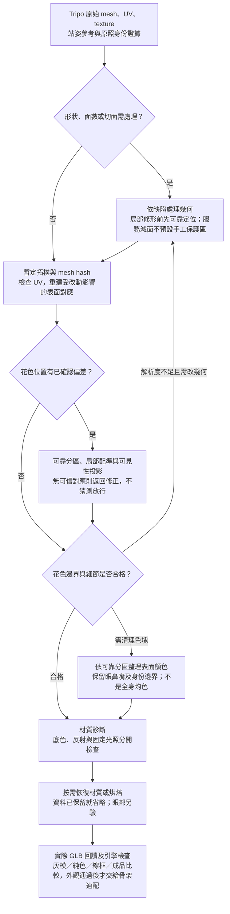

# Tripo 後處理：幾何切面、花色、眼睛與材質

日期：2026-09-30。狀態：規格與單貓實測並存；已完成切面、局部投影、眼區材質及 3500 面後處理對照，通用處理器與最終美術尚未通過。本文細化 [P07–P09](photo-to-model-spec.md)，不改動產品 README 或 catworld 資產。逐階段實物見 [workflow 第 9 節](../../workflow.md#stage-results)。

## 1. 目的與處理順序

目標是 cat.png 的自然體積、清楚而有大小變化的切面、可辨識花色、細緻眼神與霧面呈現。不能由 AI 圖判定其實際面數，也不要求所有細節都沿同一張三角網格。

幾何改動與表面標註不是完全獨立的工作。第一次定位只提供保護區；拓樸改動後需重新投影標註。最終 face ID、UV 與眼睛錨點必須綁定同一個 mesh 版本，不得拿細分前的 face ID 操作細分後的模型。

**輸入契約：** 原始資產只讀；工作副本須附 mesh hash、座標變換、實際三角面數、材質與 UV 清單。參考圖附相機／配準資訊及身份審核結果；原照是身份證據，姿勢不同時不能直接當作站姿模型的正交投影圖。

## 2. 共同前置：知道哪些地方不能亂改

局部幾何、眼部或花色處理需要可靠語意分區，不能由未知區域開始改。對這些操作，先在參考圖標註左右眼內外眼角、上下眼皮、鼻尖、嘴角、耳尖、腳掌和重要斑紋，再透過局部配準與可見表面交點建立 3D 分區。每項保存來源圖、像素位置、左右側、可信度；表面錨點保存 mesh hash、triangle ID 與重心座標。只做全資產面數驗收、受控服務減面或單一材質因子對照時，不為形式完整而強制新增逐貓手工分區。

POC 已以人工核對標註建立基準；通用自動特徵定位尚未完成，兩次自動影像配準候選也未通過。不能把人工標註成功算成自動生成成功，也不能靠全域 x/z 門檻辨識所有貓的頭。[配準實測](../generation-v001/12-auto-registration/review.json)

分區至少有：身體毛色、左右眼、眼皮、鼻、嘴、耳內、腳掌、身份斑紋邊界。眼睛保護半徑「頭寬 × 0.1」只能作候選搜尋範圍，最終保護區依眼皮輪廓，不能一個圓連附近臉斑都跳過。

## 3. 幾何切面：先形體，再分配面數，再設定法線

### 3.1 先用灰模確認形狀

關閉貼圖，檢查臉頰、眼眶、口鼻突出量、耳尖、胸腹、四肢與尾巴。融合腿、多餘肢體、扁掉的鼻口不是材質問題，需局部建模或返回生成。原照為趴姿時不直接拿它與站姿模型算全身剪影誤差；先使用已驗收的相同姿勢參考，並將其推測比例保持標記。

### 3.2 局部決定保留、減面或加面

- 身體大體積保留較大的面；眼眶、鼻口、耳尖、腳掌與尾彎保留較密幾何。不預先規定所有貓相同區域面數百分比。
- 現行目標為匯出資產約 **3500 個三角面**，優先原生請求 `face_limit=3500`；3000 僅保留歷史基準，不再預設 6000／9000 變體。原生實際達標且品質合格就省略減面；本例原生輸出 5501 面，故另測條件式減面。不能把參數值當實際面數，或把不同生成結果的差異全部歸因於面數。
- Blender 可用選定區域的 bmesh 邊細分，再對候選頂點做受限制的平滑；過度密集區才評估減面。每次改動需保護剪影、UV 接縫、特徵邊界，檢查退化三角面與部位黏連。必要時重新展 UV 和烘焙，不能假設任意減面都保留原貼圖。
- catworld 曾用一次三角面細分與平滑位置混合：`p = p_planar + k * (p_smooth - p_planar)`，k=0.6，耳尖區 k=0。這是候選方案，需限制位移並檢查體積縮小；不是全身必做。其記錄為 3075 → 12300 面。
- **只把一個平面三角形切成四個共平面三角形，不會自動產生四個不同的受光面。** 幾何曲率、面法線或表面顏色需有變化才看得出分面。也不能靠細分還原原本不存在的眼皮。
- 本輪 5128→20512 的均勻細分未通過美術驗收，不列為預設步驟。Tripo `/mesh/decimate` v1.0 在已修色的 5072 面來源上輸出 3500 面，不需人工頭／腳保護區；v2.0 則輸出 4422 面而拒絕。來源仍曾人工協助，單例不能支持跨貓成功率。[服務減面實測](../generation-v001/16-service-retopology/review.json)
- 隨機幾何起伏預設 0；catworld 的 ±0.7 mm 僅保留作對照，不把噪聲當通用美術規則。其尺度依據是標準化模型，不是貓的真實尺寸。

### 3.3 法線與拓樸凍結

身體先測 flat shading；眼球表面可以 smooth，眼皮／臉部依局部造型決定。Flat/Smooth 改變面角法線與光照插值，並不替代輪廓建模。[Blender：Shade Smooth & Flat](https://docs.blender.org/manual/en/latest/modeling/meshes/editing/face/shading.html)

保留分析網格與渲染網格的區別：UV 與硬邊可能需要拆點，不能為了「清理」焊掉渲染屬性。拓樸暫定後重建 UV、分區與來源對應；後續若為花紋加面，這些資料再更新一次。

**輸出／驗收：** 幾何工作檔、實際面數、改動區域、灰模與線框比較。重點是形體與切面大小分布，不是達到某個面數就合格。動畫階段仍須另測彎曲、穿模和法線跳變。

## 4. 花色：先正確定位，再簡化成乾淨色塊

### 4.1 確認來源，不把錯誤再烘焙一次

保留 Tripo 初始貼圖作覆蓋完整的底圖。以原照核對臉斑、鼻色、白襪、背紋等身份；已發現的例子是原照鼻尖粉色沒有完整保留在既有生成正面圖中。這要修正參考或局部花色，調 roughness 無法救回。

投影來源優先使用已驗收、同姿勢的參考圖。若直接使用原照，需要額外的姿勢／表面對應，不能只調相機就把躺姿照片準確貼到站姿四肢。

### 4.2 投影到表面，處理遮擋與來源矛盾

這是已確認花色錯位且有可信來源／對應時的修正分支，不是每隻生成貓的必經步驟。最新四視圖分支保留原生貼圖，沒有沿用舊 52 點或背部座標；完整身份仍需驗收，省略投影不等於身份已通過。

1. 身體與頭臉分別以剪影、關鍵點擬合相機；保存疊圖。只靠全身 IoU 不能保證鼻子或白襪對齊。
2. 對目標 UV 的有效 texel 求三角形內的 3D 位置，再投影到來源圖；以 z-buffer、部位標籤與來源遮罩排除遮擋及跨肢體誤投。
3. 起始權重為 `visible * max(0, n·view_dir)^4 * source_confidence * registration_confidence`；深度容差起點身長 × 0.008。這些值需以細腿、近接表面案例校準。
4. 一個來源是橘色、另一個是黑色時，不直接加權平均。先選可信且配準正確的來源；無法判斷則返回修正。只有同一花色區內的小幅色差才考慮融合。
5. 左右不鏡射。沒有原照證據的表面仍標 inferred，即使 AI 四視圖彼此一致也一樣。

### 4.3 大面色塊與關鍵細節分開

**26 受控 POC：** 在固定 3500 面的來源上，新增以最大 Lab 色差自適應整理色塊的 [兩強度對照](../generation-v001/26-adaptive-facet-color/review.json)。只在貼圖中將原三角區分成最多兩層子區，幾何、UV 與法線不變；色差超出上限就細分或保留。這次沒有手工眼罩或部位座標，兩版都完成實際 GLB 回讀、兩側全身及三角度臉部渲染。身體／尾巴有改善，但 B 眉部塊偏大，胸邊仍細碎；只證明可取得部分改善，不取代語義分區、照片身份或最終美術驗收。色差上限不是「所有眼鼻一定安全」的保證，不把提高全域強度列為無限修法。 **後續使用者驗收：整體看不出差別，A/B 拒絕採用。** 局部處理存在但效果不足，後续美術判斷以正常全身觀看為必要條件，不用放大局部或像素變化推論成功。

- 身體同一毛色區內，以 linear sRGB 的面積加權代表色整理毛絲與高頻雜訊，保留受控色階。PNG sRGB 解碼一次；如果讀取介面已提供線性值，不可再做一次轉換。
- **一個面跨黑／白或鼻尖粉色等重要邊界，不可直接平均或多數決。** 優先保留面內的清楚貼圖邊界；需要邊界沿切面時再局部加面，回到幾何步驟。極細辨識紋理不必強迫變成網格邊。
- 不將所有黑、橘、白各壓成唯一顏色；也不預設每面隨機改亮暗。先分清是毛色層次、光照還是生成雜訊。
- 陰影不等於毛色。優先在參考階段降低強光與陰影；無法從單張圖可靠分離的暗區不能宣稱已還原真實反照率。單純選「不烘焙燈光」也不會移除來源圖片早已帶入的陰影。

**承載方式：** 第一輪用一張 UV 貼圖同時容納身體色塊與眼鼻細節，方便保留表面對應。若改用頂點色，逐面固定色應存於 face-corner／拆分後頂點，不能共用一個頂點色導致鄰面混色。兩條路都由程式按表面對應產生，ImageGen 不直接編輯最終 UV 圖集。

**驗收：** 不受光的 base-color 視圖先看身份和髒色，再在三分之四視角看接縫。這一步先回答「花色對不對」，不能用漂亮的棚拍陰影遮掉錯位。

## 5. 眼睛：定位、眼皮形狀、虹膜與反光分別處理

### 5.1 定位方法

依左右眼角、上下眼皮輪廓與頭部朝向建立各自的局部座標，再對應到可見 3D 眼區；保存對應誤差。不以「找黃色像素」作通用眼睛偵測，也不強制左右眼色、位置和形狀鏡像一致。

catworld `eyes_locate.py` 實際依黃綠色門檻和固定 x/z 區間找眼，缺某一側時會繼續；通用版本必須檢查定位缺失、重複候選、遮擋與錯把橘毛當眼睛。缺少證據時回到補足／核對標註，不輸出一對假定正確的眼睛。

### 5.2 依缺陷選處理，不每隻都重畫

| 情況 | 處理方式 | 不能用什麼代替 |
| --- | --- | --- |
| 原生眼睛位置、形狀與眼色均合格 | 保留貼圖及眼區細節，排除身體逐面平均 | 不套統一的大圓眼或夜瞳模板 |
| 眼區幾何合格，但眼色／貼圖位置錯 | 用已驗收臉部參考做局部配準和替換；確認舊瞳孔完全移除、眼周花色保留 | 不在舊眼睛上疊一對新眼睛 |
| 眼眶、眼皮或眼球體積不合格 | 局部建模，或適配眼球＋眼皮元件；完成後重新定位、展 UV、烘焙 | 貼圖不能修正側面突起、凹陷或眼皮輪廓 |
| 需要轉眼、眨眼 | 加入受控眼球方向與眼皮骨骼／shape key；另測閉合、穿模、蒙皮 | 靜態眼睛貼圖不等於可用的眼部動畫系統 |

眼色保留照片支持的個體差異，包括異色瞳。瞳孔大小與眼睛開合受光線和表情影響；cat.png 的半閉眼可作風格參考，不強迫所有玩家貓固定同一表情。

第一輪可以保留合格的原生眼睛；模組化眼球與眼皮是後續候選，尚未實作。若用動態高光，先避免同一處又保留強烈的貼圖高光；不能宣稱從單張反光照片已精確恢復被遮住的虹膜。

**驗收：** 正面、左右三分之四與側面近照；核對眼角位置、眼皮輪廓、虹膜顏色、瞳孔數量和視線。若宣稱支援眼部動畫，還需測轉眼及完整閉眼。

## 6. UV、材質、燈光與引擎呈現

### 6.1 UV 與烘焙

先檢查 UV 是否重疊、鏡射共用或超出預期範圍。不對稱花色不能共用同一個左右 UV 區域；必要時重新展開，從有來源對應的表面重烘焙。

本地 atlas 起點 2048×2048，padding 16 px；眼部需有足夠 texel density。島間距要容得下 padding，不能互相覆蓋。引擎縮圖／mipmap 下仍需檢查黑邊、白邊與串色，16 px 不是任何觀看距離都有效的保證。Blender 的烘焙 margin 用於減少 filtering/mipmap 引起的 UV 接縫。[Blender：Render Baking](https://docs.blender.org/manual/en/latest/render/cycles/baking.html)

### 6.2 材質候選值

| 區域 | 起點 | 目的與限制 |
| --- | --- | --- |
| 身體 | metallic=0；roughness=0.9；生成 normal map 關閉 | 霧面基準；切面主要依靠幾何法線，避免毛絲法線引入雜訊 |
| 反射強度對照 | glTF `KHR_materials_specular.specularFactor=0.3` | 最新單表面候選；Blender 回讀為 Specular IOR Level≈0.15，尚非跨貓或引擎已驗證預設 |
| 眼區 | 先保留可驗收原材質；另測 roughness=0.3（比較 0.2／0.4） | 給適量眼神反光；需有可靠區域與表面形狀，不保證只是調數值就自然 |
| 鼻／眼皮 | 先沿用基準，只有視覺證據支持時另分區 | 先驗證顏色與造型，避免無目的增加材質 |

眼區 roughness=0.3、身體=0.9 已有 [實際渲染證據](../generation-v001/10-style-recovery/eye-material/report.json)，但遮罩仍依人工眼部輪廓，效果有限，沒有完成眼球／眼皮幾何與動畫。0.2／0.4 對照尚未執行，不把它們寫成已測數值。材質可由區域遮罩控制，並不一定每個部位建立獨立 draw call。生成請求 `pbr=false` 只描述生成輸出選項，不等於遊戲模型應使用 unlit；本地仍可用簡單 PBR 材質接受動態光照。

服務處理後另檢查材質契約。本例 v1.0 減面遺失來源 `metallicFactor=0`，令毛色變成金屬呈現；來源 specular 設定也遺失。已比較只還原材質常數與重烘焙，後者在固定四視角較接近來源，保留為本例工作候選。此規則從來源讀值，不用逐貓手調；尚只測單一 mesh／材質。不一定先修色再減面：尚未修色的新資產可先固定拓樸，避免多一次重烘焙，但其品質仍需實測。[材質故障與修復](../generation-v001/16-service-retopology/review.json)

上述遺失不是所有服務輸出的必然現象。[24 最新減面](../generation-v001/24-multiview-budget/review.json)保留 metallic=0、roughness≈0.9 及 2048 貼圖；對應表面色差未觸發修復，因此省略材質恢復與重烘焙。貼圖編碼 hash 改變本身不足以判定需要重烘焙。

[25 材質隔離實測](../generation-v001/25-appearance-diagnostic/review.json)以同一模型兩角度比較原材質、零鏡面與底色直出；反射確實增亮深色表面，底色仍保有柔化毛邊。因此只測一個共用反射強度候選，沒有重畫底色。候選 GLB 的幾何、UV、法線和貼圖二進位資料完全相同，Blender 匯入生效；眼睛尚未分區，不能宣稱已完成眼材質。此擴充用於控制非金屬表面的鏡面反射，接收端須支援才會呈現預期效果；Unity 尚未驗證。[glTF 官方規格](https://github.com/KhronosGroup/glTF/tree/main/extensions/2.0/Khronos/KHR_materials_specular)

Roughness 控制微表面反射的擴散程度，不會改變花色邊界或幾何切面。不同 Blender／Unity shader、燈光與 tone mapping 可能呈現不同效果，匯出後必須在目標引擎重驗。[Blender：Principled BSDF](https://docs.blender.org/manual/en/dev/render/shader_nodes/shader/principled.html)

### 6.3 用固定檢查場景分離問題

同一組相機、曝光、白平衡、背景與色彩管理設定下保存：

1. **灰模：** 看輪廓、切面密度和眼眶幾何。
2. **純 base color：** 看花色定位與來源圖片帶入的光影。
3. **線框＋分區疊圖：** 看細節是否被大面吞掉、眼睛保護區是否越界。
4. **中性光與柔和棚拍各一套：** 看材質及 cat.png 風格，不能只選最漂亮的角度。
5. **目標引擎畫面：** 看色彩差異、UV 接縫、mipmap、法線與反光。色彩管理配置和引擎版本隨資產保存。

## 7. catworld 可以參考到什麼程度

- `pipeline/PIPELINE.md` 記載目前切面成品採用保留原生眼睛的 `lp_proj.png`，**不跑 eyes_paint**。存在 `eyes_paint.py` 不代表該效果就是最終成品採用的效果。
- `facet_texture.py` 實際做每面平均色、眼睛 11 mm 內保留原貼圖，且用 gamma 2.2 近似；新版需改為依輸入色彩空間正確處理，並加鼻嘴與重要花色邊界的例外。
- 同程式以最近有效像素填滿全部未覆蓋 UV 像素；新版需檢查島間距、重疊與 padding，而不是無條件照抄。
- `tripo_decimate.py` 用固定頭部中心與座標區間提高頭部減面保留程度；這是案例技巧，尚非可適應所有貓的語意分區。
- `render_views.py` 具有固定位置的臉部相機。更換臉型或模型尺度時須依語意錨點配置，不能假設原相機永遠拍得到臉。

上述是本輪閱讀程式與紀錄取得的證據，沒有重跑或修改 catworld。通用定位、跨視角配準、眼部適配與自動外觀評分仍是主要未驗證部分。

## 8. 實作交付與下一個驗證單位

每次輸出 `geometry.blend`、`appearance.glb`、base-color atlas、分區／推測遮罩、來源對應、相機設定、材質設定、比較圖和 QA 紀錄。QA 包含人工介入次數、耗時與失敗原因；工程成功與視覺合格分開。

已完成同一生成模型的原生／flat／均勻細分、局部修色及眼區材質比較，之後補側背投影與 3500 面對照。失敗均有保留；詳見 [實驗時序](../generation-v001/experiment-history.json)。本輪部分語意分區仍是人工點位或座標；完整推測遮罩、跨貓自動定位、引擎畫面與變形驗收仍未完成。

下一個外觀驗證必須先區分參考圖帶入的碎色、Tripo 形狀缺陷和後處理問題，再選有通用價值的單一變因；不可又預設全身加密或新增本貓專用座標。當前工作候選達到 3500 面與 Blender 匯出回讀，但未通過 cat.png、身份或動畫品質，不承諾零誤差或固定自動成功率。
